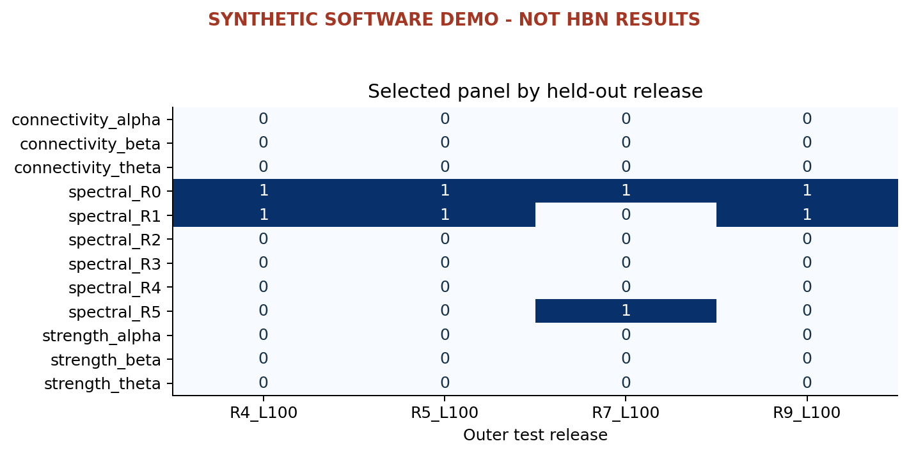
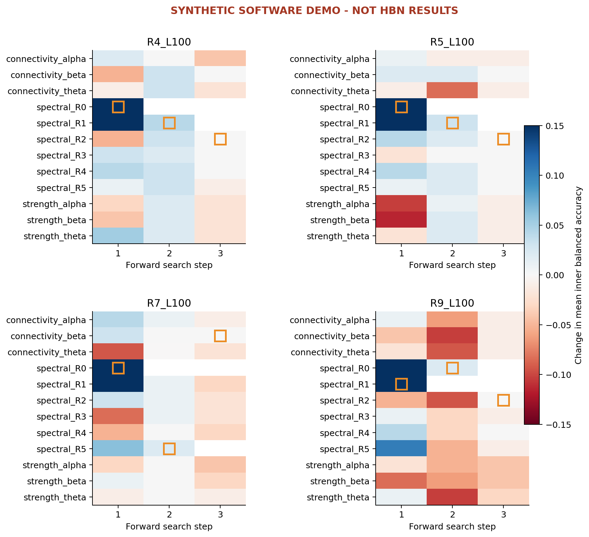

# SeqMap

Sequential EEG feature-combination selection with random forests, nested release evaluation, and visual stability audits.

**Research software and manuscript draft. Demonstration heatmaps use synthetic fixtures, not HBN results.**

## Windows quick start

Use a separate virtual environment from Repo3:

```powershell
git clone https://github.com/Mj-heidari/Repo4.git
cd Repo4
py -3.12 -m venv .venv
.\.venv\Scripts\python.exe -m pip install -e ".[bdf]"
.\.venv\Scripts\python.exe -m unittest discover -s tests -v
.\.venv\Scripts\python.exe -m hbn_r4.cli demo --output demo_data/features.csv
.\.venv\Scripts\python.exe -m hbn_r4.cli search --features demo_data/features.csv --config configs/smoke.json --output outputs/smoke
.\.venv\Scripts\python.exe -m hbn_r4.cli plot --results outputs/smoke
```

See [Windows_Run_Guide.pdf](docs/Windows_Run_Guide.pdf) for both projects and BDF preparation. Use a new output directory per run.

Your dataset root is `D:\EEG_Dataset\HBN_100Hz`, with folders `R4_L100_bdf`, `R5_L100_bdf`, `R7_L100_bdf`, and `R9_L100_bdf`. The shared data layer supports `inspect-data`, `inspect-bdf`, `prepare-bdf`, `prepare-cohort`, `validate-data`, `convert-mat`, and `extract`. Diagnoses, channels, EO/EC event intervals and preprocessing decisions require verification on the real files.

## Research runs

The same extracted feature CSV can be used in both repositories. From Repo4, if Repo3 is a sibling folder:

```powershell
.\.venv\Scripts\python.exe -m hbn_r4.cli search --features ../Repo3/local/features.csv --config configs/research_blocks.json --output outputs/research_blocks
.\.venv\Scripts\python.exe -m hbn_r4.cli plot --results outputs/research_blocks
```

| Configuration | Search | Candidate forest fits per outer release |
|---|---|---:|
| `research_blocks.json` | 12 regional/band blocks, up to 6 steps | 171 |
| `research_bands.json` | 36 individual static band-power features, up to 10 steps | 945 |
| `research_features_expensive.json` | 315 individual features, up to 12 steps | 11,142 |

Each count excludes three final comparator fits. Start with block search. Individual searches can be expensive; no runtime or >90% accuracy is promised.

The best next addition is selected by mean inner balanced accuracy. A one-SE parsimony heuristic chooses a compact panel along the greedy trajectory. The result is not an exhaustive/global optimum. Outer release labels never enter selection. Random forest evaluates signal-processing features; it does not extract spectral features from raw EEG.

## Visual outputs

`plot` exports PDF and PNG versions of six views:

1. Selected panel by held-out release.
2. Co-selection frequency (not biological interaction strength).
3. Conditional inner-score gain for candidate additions.
4. Panel size versus inner score, with chosen panels marked.
5. Untouched-release performance of selected, first-step and all-candidate models.
6. Individual feature selection frequency.

Complete candidates and paths are retained in JSON; plots of large feature searches show a readable subset. Outer models, predictions, paired family-bootstrap comparisons, feature frequencies and Jaccard similarities are saved. There is one selected panel per outer fold; a descriptive consensus is not a newly validated universal best panel.

See [EXPERIMENTS.md](docs/EXPERIMENTS.md), [VALIDATION.md](docs/VALIDATION.md), and the draft in `paper/main.pdf`. Rebuild the paper using `python scripts/render_bibliography.py`, followed by two `pdflatex main.tex` runs inside `paper/`.

## Synthetic visualization preview

The figures below are software fixtures only. Actual HBN plots are generated by running the same commands on your audited feature table.



